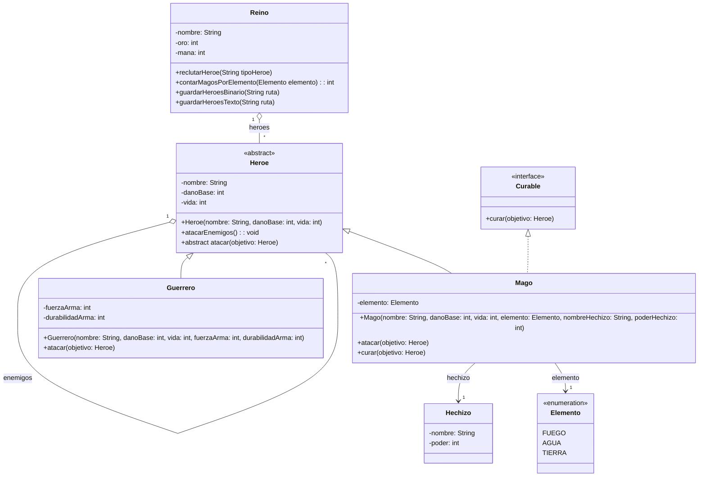

# Práctica 10 – Reino mágico: Héroes y hechizos

Un programa simula combates entre héroes que pertenecen a un reino. Los héroes pueden ser magos o guerreros, y el reino los recluta gastando recursos.

## Diagrama UML

## A. (15 puntos) Definición de clases y atributos
Defina todas las clases, la interfaz y el enum del diagrama (encabezado y **todos** los atributos).
1. Escriba el constructor de `Heroe`, `Mago` y `Guerrero`. El constructor de `Mago` recibe el nombre y el poder del hechizo para crear su `Hechizo`. La lista de enemigos se crea vacía.
2. `Heroe` es abstracta. Escriba sus métodos abstractos.
3. Defina el enum `Elemento` y la interfaz `Curable`; `Mago` debe implementarla.
4. Defina la excepción propia verificada `ManaInsuficienteException` (extiende de `Exception`).
5. Las clases que se guardan en archivos binarios deben ser serializables.

## B. (65 puntos) Métodos por implementar

| Clase | Puntos | Método |
|---|---|---|
| Mago | 5 | **atacar**: baja la vida del objetivo en un total de danoBase + poder del hechizo. |
| Guerrero | 5 | **atacar**: baja la vida del objetivo en un total de danoBase + fuerzaArma. También baja la durabilidadArma en 2. |
| Mago | 5 | **curar** (de la interfaz `Curable`): sube la vida del objetivo en 20. |
| Heroe | 10 | **atacarEnemigos**: ataca a todos los héroes de la lista de enemigos. Si la vida de un héroe queda en cero o negativa, debe eliminarse de la lista de enemigos. |
| Reino | 15 | **reclutarHeroe**: recibe un String "mago" o "guerrero" con el tipo de héroe a crear. Un mago cuesta 10 de mana (se crea con danoBase 10, vida 80, elemento FUEGO, hechizo "Bola de fuego" de poder 25) y un guerrero cuesta 20 de oro (se crea con danoBase 12, vida 120, fuerzaArma 15, durabilidadArma 10). Use como nombre el tipo seguido de la cantidad de héroes del reino más uno (por ejemplo "Mago1"). Lanzar `ManaInsuficienteException` si no hay mana suficiente para un mago, `Exception` si no hay oro suficiente para un guerrero y `Exception` si el tipo es desconocido. |
| Reino | 10 | **contarMagosPorElemento**: recibe un `Elemento` y retorna la cantidad de magos del reino con ese elemento. |
| Reino | 5 | **guardarHeroesBinario**: guarda en un archivo binario todos los héroes del reino. |
| Reino | 10 | **guardarHeroesTexto**: guarda en un archivo de texto la información de todos los héroes con el formato:  `Tipo de héroe: <Mago o Guerrero>` `Nombre: <nombre>` `Daño base: <danoBase>` `Vida: <vida>` `Valor adicional: <para Mago el poder de su hechizo y para Guerrero la fuerzaArma>` |

Puede usar métodos desarrollados en otros puntos. Si usa métodos auxiliares no incluidos en el enunciado, debe implementarlos completamente.
