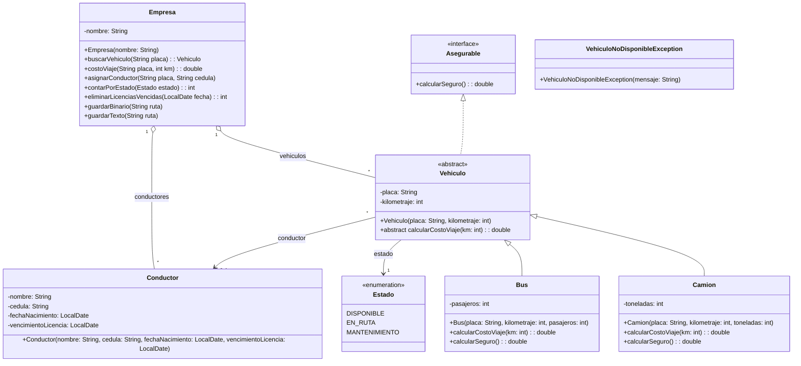

# Práctica 11 – Flota de transporte: Vehículos y conductores

Una empresa de transporte administra una flota de vehículos (buses y camiones) y una lista de conductores. Cada vehículo puede asignarse a un conductor, tiene un estado y puede asegurarse.

## Diagrama UML

## A. (15 puntos) Definición de clases y atributos
Defina todas las clases del diagrama (encabezado y **todos** los atributos).
1. Escriba el constructor de `Empresa`, `Vehiculo`, `Bus`, `Camion` y `Conductor`. Las listas de vehículos y de conductores de `Empresa` se crean vacías. Todo vehículo nuevo se crea en estado `DISPONIBLE` y sin conductor (`null`).
2. `Vehiculo` es abstracta e implementa la interfaz `Asegurable`. Escriba su método abstracto `calcularCostoViaje`. Defina también la interfaz `Asegurable` (con el método `calcularSeguro`).
3. Defina el enum `Estado` con los valores `DISPONIBLE`, `EN_RUTA` y `MANTENIMIENTO`.
4. Defina la excepción verificada `VehiculoNoDisponibleException`, que hereda de `Exception` y recibe el mensaje en su constructor.
5. Las clases `Vehiculo`, `Bus`, `Camion` y `Conductor` deben poder guardarse en un archivo binario.

## B. (65 puntos) Métodos por implementar

| Clase | Puntos | Método |
|---|---|---|
| Bus | 5 | **calcularCostoViaje**: retorna el costo de un viaje de `km` kilómetros. Cada kilómetro cuesta 2000 más 150 por cada pasajero. |
| Camion | 5 | **calcularCostoViaje**: retorna el costo de un viaje de `km` kilómetros. Cada kilómetro cuesta 3000 más 400 por cada tonelada. Si el camión lleva más de 20 toneladas, al costo total se le suma un recargo del 10%. |
| Bus | 2 | **calcularSeguro**: retorna 1.500.000 más 10.000 por cada pasajero. |
| Camion | 2 | **calcularSeguro**: retorna 2.000.000 más 50.000 por cada tonelada. |
| Empresa | 5 | **buscarVehiculo**: recibe una placa y retorna el vehículo que la tiene. Lanzar una excepción si no existe. |
| Empresa | 5 | **costoViaje**: recibe la placa de un vehículo y los kilómetros del viaje, y retorna el costo del viaje de ese vehículo. Lanzar una excepción si el vehículo no existe. |
| Empresa | 12 | **asignarConductor**: recibe la placa de un vehículo y la cédula de un conductor. Lanzar una excepción si el vehículo o el conductor no existen. Si el vehículo no está `DISPONIBLE`, lanzar `VehiculoNoDisponibleException`. En caso contrario, asigna el conductor al vehículo y cambia el estado del vehículo a `EN_RUTA`. |
| Empresa | 7 | **contarPorEstado**: recibe un `Estado` y retorna la cantidad de vehículos que tienen ese estado. |
| Empresa | 10 | **eliminarLicenciasVencidas**: recibe una fecha y elimina de la lista de conductores a todos aquellos cuyo vencimiento de licencia sea anterior a esa fecha. Retorna la cantidad de conductores eliminados. |
| Empresa | 4 | **guardarBinario**: guarda en un archivo binario la lista de vehículos y la lista de conductores. |
| Empresa | 8 | **guardarTexto**: guarda en un archivo de texto la información de todos los vehículos, separados por una línea en blanco, con el formato:  `Tipo de vehículo: <Bus o Camion>` `Placa: <placa>` `Estado: <estado>` `Valor adicional: <para Bus los pasajeros y para Camion las toneladas>` `Conductor: <nombre del conductor, o "Sin conductor" si no tiene>` |

Puede usar métodos desarrollados en otros puntos. Si usa métodos auxiliares no incluidos en el enunciado, debe implementarlos completamente.
