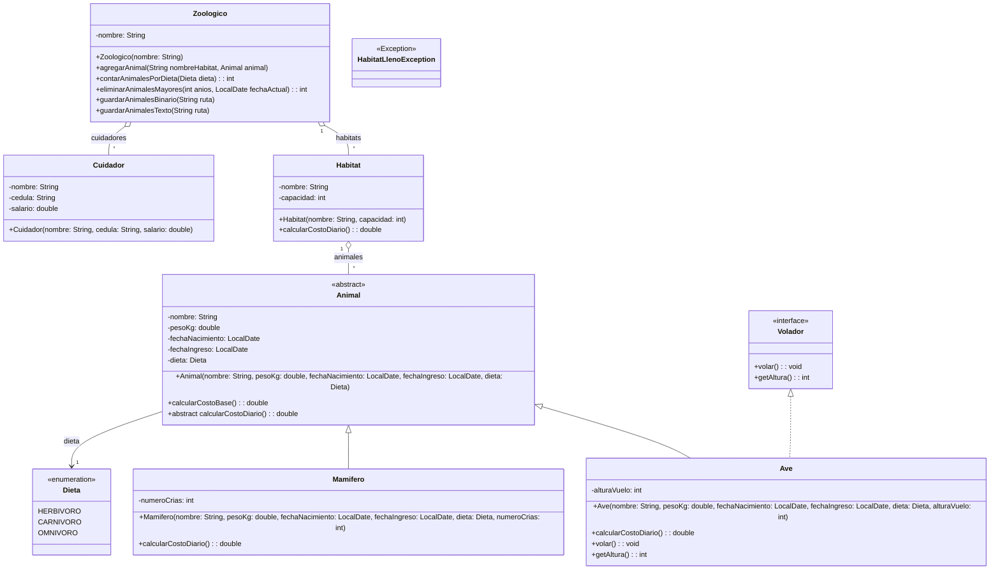

# Práctica 12 – Zoológico: Animales, hábitats y cuidadores

Un programa administra un zoológico formado por hábitats, cada uno con una capacidad máxima de animales, y por un grupo de cuidadores. Los animales pueden ser aves o mamíferos.

## Diagrama UML

## A. (15 puntos) Definición de clases y atributos
Defina todas las clases del diagrama (encabezado y **todos** los atributos).
1. Escriba el constructor de `Zoologico`, `Habitat`, `Cuidador`, `Animal`, `Ave` y `Mamifero`. Las listas de hábitats y de cuidadores de `Zoologico`, y la lista de animales de `Habitat`, se crean vacías. Los constructores de `Ave` y `Mamifero` reciben también los datos de `Animal` y los pasan al constructor de la superclase.
2. `Animal` es abstracta. Escriba su método abstracto `calcularCostoDiario`. `Animal`, `Habitat` y sus subclases deben poder guardarse en un archivo binario (serializables).
3. Defina el enum `Dieta` con los valores `HERBIVORO`, `CARNIVORO` y `OMNIVORO`.
4. Defina la interfaz `Volador` con los métodos `volar()` y `getAltura()`, e implemente ambos en `Ave`. El método `volar` sube la altura de vuelo del ave en 20 metros y `getAltura` retorna la altura de vuelo actual.
5. Defina la excepción propia verificada `HabitatLlenoException` (extiende de `Exception`) que recibe un mensaje.

## B. (65 puntos) Métodos por implementar

| Clase | Puntos | Método |
|---|---|---|
| Animal | 5 | **calcularCostoBase**: retorna el peso del animal multiplicado por el costo por kilo según su dieta: HERBIVORO 2.0, CARNIVORO 5.0 y OMNIVORO 3.0. |
| Ave | 5 | **calcularCostoDiario**: retorna el costo base más un recargo de 5 si su altura de vuelo es mayor a 100. |
| Mamifero | 5 | **calcularCostoDiario**: retorna el costo base más 10 por cada cría que tenga el mamífero. |
| Habitat | 5 | **calcularCostoDiario**: retorna la suma del costo diario de todos los animales del hábitat. |
| Zoologico | 10 | **agregarAnimal**: recibe el nombre de un hábitat y un animal, y agrega el animal a ese hábitat. Si no existe un hábitat con ese nombre, lanzar una excepción genérica (`Exception`). Si el hábitat ya tiene tantos animales como su capacidad, lanzar `HabitatLlenoException`. |
| Zoologico | 10 | **contarAnimalesPorDieta**: retorna la cantidad de animales de todos los hábitats del zoológico que tengan la dieta recibida. |
| Zoologico | 10 | **eliminarAnimalesMayores**: recibe una cantidad de años y la fecha actual. Elimina de todos los hábitats los animales cuya edad (en años cumplidos entre su fecha de nacimiento y la fecha actual, usando `Period`) sea mayor a la cantidad recibida. Retorna cuántos animales se eliminaron. |
| Zoologico | 5 | **guardarAnimalesBinario**: guarda en un archivo binario la lista con todos los animales del zoológico. |
| Zoologico | 10 | **guardarAnimalesTexto**: guarda en un archivo de texto la información de todos los animales de cada hábitat, con el siguiente formato (una línea en blanco entre animales):  `Hábitat: <nombre del hábitat>` `Tipo: <Ave o Mamífero>` `Nombre: <nombre del animal>` `Dieta: <dieta>` `Peso: <pesoKg>` `Costo diario: <costo diario del animal>` |

Puede usar métodos desarrollados en otros puntos. Si usa métodos auxiliares no incluidos en el enunciado, debe implementarlos completamente.
