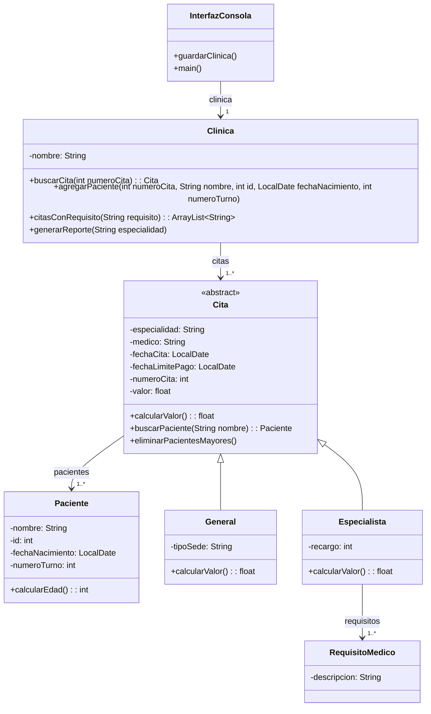

# Práctica 1 – Sistema de citas de una clínica

Una clínica necesita un sistema orientado a objetos para gestionar sus citas generales y de especialista, y los pacientes asignados a cada cita.

## Diagrama UML

## A. (15 puntos) Definición de clases y atributos
Defina todas las clases del diagrama (encabezado y **todos** los atributos). Para `Cita`, `General` y `Especialista` escriba el constructor con parámetros. La clase `Cita` es abstracta: escriba sus métodos abstractos.

## B. (65 puntos) Métodos por implementar

| Clase | Puntos | Método |
|---|---|---|
| InterfazConsola | 5 | **guardarClinica**: guarda la clínica en un archivo serializado llamado `clinica.dat`. |
| General y Especialista | 10 | **calcularValor**: en citas de especialista el valor se incrementa con el recargo. En citas generales el incremento depende del tipo de sede: "Principal" (15%), "Norte" (8%) o "Satélite" (3%). Retorna el valor incrementado. |
| Cita | 5 | **buscarPaciente**: dado el nombre del paciente, retorna el objeto `Paciente` si existe o `null` en caso contrario. |
| Clinica | 10 | **agregarPaciente**: dado un número de cita, nombre, ID, fecha de nacimiento y número de turno, agrega un paciente a la cita. Si el paciente ya existe, genera una excepción. Suponga que existe `Cita buscarCita(int numeroCita)` que retorna la cita o `null`. |
| Cita | 15 | **eliminarPacientesMayores**: elimina los pacientes con 65 años o más (se atenderán a domicilio). Suponga que `Paciente` tiene `int calcularEdad()`. |
| Clinica | 10 | **citasConRequisito**: retorna un `ArrayList<String>` con las citas de especialista que tengan el requisito recibido como parámetro (por ejemplo "ayuno", "orden médica"). Cada String: `Clinica-numeroCita-especialidad-medico`. |
| Clinica | 10 | **generarReporte**: recibe una especialidad y genera `reporteEspecialidad.txt` con todas las citas de esa especialidad. Formato: `<Tipo de cita>-<Toda la información específica de la cita>`. |
