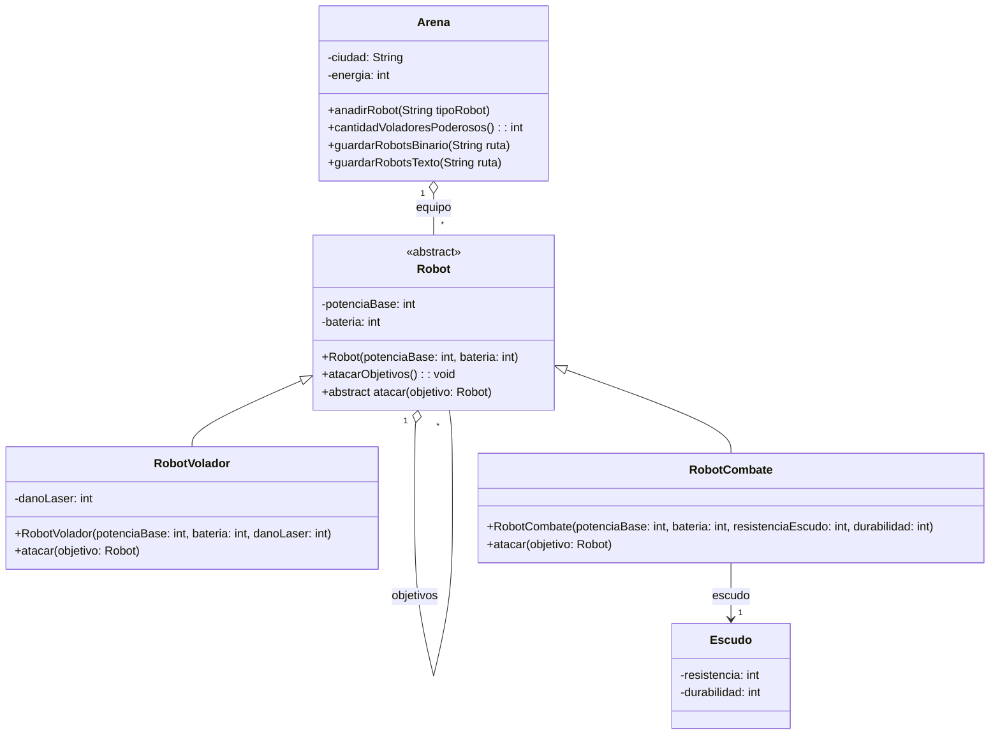

# Práctica 2 – Torneo de robots: Arenas de combate

Un programa simula combates entre robots que pertenecen a una arena de un torneo.

## Diagrama UML

## A. (15 puntos) Definición de clases y atributos
Defina todas las clases del diagrama (encabezado y **todos** los atributos).
1. Escriba el constructor de `Robot`, `RobotCombate` y `RobotVolador`. El constructor de `RobotCombate` recibe resistencia y durabilidad para crear el escudo. La lista de objetivos se crea vacía.
2. `Robot` es abstracta. Escriba sus métodos abstractos.

## B. (65 puntos) Métodos por implementar

| Clase | Puntos | Método |
|---|---|---|
| RobotVolador | 5 | **atacar**: baja la batería del objetivo en un total de potenciaBase + danoLaser. |
| RobotCombate | 5 | **atacar**: baja la batería del objetivo en un total de potenciaBase + resistencia del escudo. También baja la durabilidad del escudo en 2. |
| Robot | 15 | **atacarObjetivos**: ataca a todos los robots de la lista de objetivos. Si la batería de un robot queda en cero o negativa, debe eliminarse de la lista de objetivos. |
| Arena | 15 | **anadirRobot**: recibe un String "volador" o "combate" con el tipo de robot a crear. Un robot de combate cuesta 8 de energía y un volador 12. Lanzar una excepción si no hay energía suficiente. |
| Arena | 10 | **cantidadVoladoresPoderosos**: retorna la cantidad de robots voladores del equipo cuyo danoLaser sea mayor a 40. |
| Arena | 5 | **guardarRobotsBinario**: guarda en un archivo binario todos los robots de la arena. |
| Arena | 10 | **guardarRobotsTexto**: guarda en un archivo de texto la información de todos los robots con el formato:  `Tipo de robot: <Combate o Volador>` `Potencia base: <potenciaBase>` `Batería: <bateria>` `Valor adicional: <para Volador el danoLaser y para Combate la resistencia de su escudo>` |

Puede usar métodos desarrollados en otros puntos. Si usa métodos auxiliares no incluidos en el enunciado, debe implementarlos completamente.
