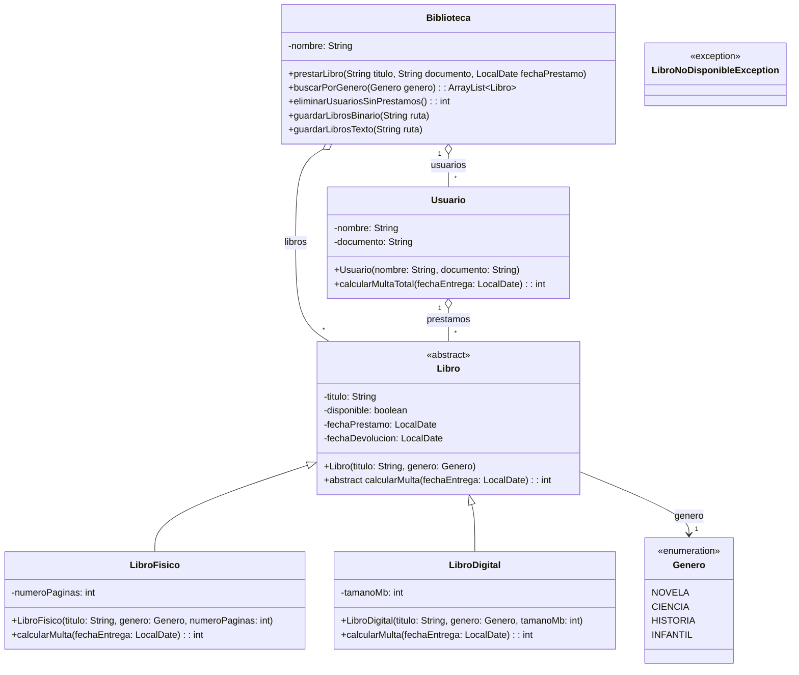

# Práctica 3 – Biblioteca: Préstamo de libros

Un programa administra una biblioteca que presta libros físicos y digitales a sus usuarios.

## Diagrama UML

## A. (15 puntos) Definición de clases y atributos
Defina todas las clases del diagrama (encabezado y **todos** los atributos).
1. Escriba el constructor de `Libro`, `LibroFisico`, `LibroDigital`, `Usuario` y `Biblioteca`. Al crear un libro este queda disponible (`disponible = true`) y sus fechas de préstamo y devolución quedan en `null`. Las listas `prestamos` (del usuario), `libros` y `usuarios` (de la biblioteca) se crean vacías.
2. `Libro` es abstracta. Escriba su método abstracto.
3. Defina el enum `Genero` con los valores `NOVELA`, `CIENCIA`, `HISTORIA` e `INFANTIL`.
4. Defina la excepción verificada `LibroNoDisponibleException` (hereda de `Exception`).
5. Las clases `Libro` y `Usuario` deben poder guardarse en un archivo binario.

## B. (65 puntos) Métodos por implementar

| Clase | Puntos | Método |
|---|---|---|
| LibroFisico | 5 | **calcularMulta**: recibe la fecha de entrega y calcula los días de retraso entre `fechaDevolucion` y la fecha de entrega. Si no hay retraso (días ≤ 0) la multa es 0. Si lo hay, la multa es 1000 por cada día de retraso y, si el libro tiene más de 500 páginas, se suma además un recargo fijo de 2000. |
| LibroDigital | 5 | **calcularMulta**: igual que en el libro físico, pero la multa es 300 por cada día de retraso, con un máximo de 3000. Si no hay retraso la multa es 0. |
| Usuario | 10 | **calcularMultaTotal**: recibe la fecha de entrega y retorna la suma de las multas de todos los libros que el usuario tiene en préstamo. |
| Biblioteca | 15 | **prestarLibro**: recibe el título de un libro, el documento de un usuario y la fecha de préstamo. Lanzar una `Exception` si el libro o el usuario no existen, o si el usuario ya tiene 3 préstamos. Lanzar `LibroNoDisponibleException` si el libro no está disponible. Si todo es válido, el libro deja de estar disponible, su `fechaPrestamo` es la fecha recibida, su `fechaDevolucion` es 7 días después y el libro se agrega a los préstamos del usuario. |
| Biblioteca | 5 | **buscarPorGenero**: retorna una lista con los libros disponibles del género recibido. |
| Biblioteca | 10 | **eliminarUsuariosSinPrestamos**: elimina de la biblioteca a los usuarios que no tienen ningún libro en préstamo y retorna la cantidad de usuarios eliminados. |
| Biblioteca | 5 | **guardarLibrosBinario**: guarda en un archivo binario todos los libros de la biblioteca. |
| Biblioteca | 10 | **guardarLibrosTexto**: guarda en un archivo de texto la información de todos los libros con el formato:  `Tipo de libro: <Físico o Digital>` `Título: <titulo>` `Género: <genero>` `Valor adicional: <para Físico el numeroPaginas y para Digital el tamanoMb>`  Deje una línea en blanco entre un libro y el siguiente. |

Puede usar métodos desarrollados en otros puntos. Si usa métodos auxiliares no incluidos en el enunciado, debe implementarlos completamente.
