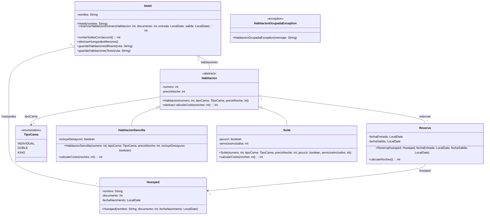

# Práctica 4 – Hotel: Habitaciones y reservas

Un hotel necesita un sistema para administrar sus habitaciones (sencillas y suites), sus huéspedes y las reservas de cada habitación.

## Diagrama UML

## A. (15 puntos) Definición de clases y atributos
Defina todas las clases del diagrama (encabezado y **todos** los atributos). Las clases `Hotel`, `Habitacion`, `HabitacionSencilla`, `Suite`, `Huesped` y `Reserva` deben poder guardarse en un archivo binario.
1. Escriba el constructor de `Hotel`, `Habitacion`, `HabitacionSencilla`, `Suite`, `Huesped` y `Reserva`. Las listas (`habitaciones` y `huespedes` de `Hotel`, `reservas` de `Habitacion`) se crean vacías.
2. `Habitacion` es abstracta. Escriba su método abstracto `calcularCosto`.
3. Defina el enum `TipoCama` con los valores `INDIVIDUAL`, `DOBLE` y `KING`.
4. Defina la excepción propia verificada `HabitacionOcupadaException` (hereda de `Exception`) que recibe un mensaje en su constructor.

## B. (65 puntos) Métodos por implementar

| Clase | Puntos | Método |
|---|---|---|
| Reserva | 5 | **calcularNoches**: retorna el número de noches entre la fecha de entrada y la fecha de salida (use `ChronoUnit.DAYS.between`). |
| HabitacionSencilla | 5 | **calcularCosto**: recibe el número de noches y retorna `precioNoche * noches`. Si incluye desayuno, se suman 12000 por cada noche. |
| Suite | 10 | **calcularCosto**: recibe el número de noches y retorna `(precioNoche + serviciosIncluidos * 15000) * noches`. Si tiene jacuzzi, se suma además un recargo fijo de 40000 (una sola vez por estadía). |
| Hotel | 15 | **reservarHabitacion**: recibe el número de la habitación, el documento del huésped y las fechas de entrada y salida. Lanza una excepción (`Exception`) si la salida no es posterior a la entrada, si no existe la habitación o si no existe el huésped. Lanza `HabitacionOcupadaException` si la nueva reserva se cruza con alguna reserva existente de la habitación (hay cruce cuando `entrada` es anterior a la salida de la otra reserva **y** `salida` es posterior a la entrada de la otra reserva; salir el mismo día en que otra reserva entra **no** es cruce). Si todo es válido, crea la `Reserva`, la agrega a la habitación y retorna el costo de la estadía (`calcularCosto` con las noches de la reserva). |
| Hotel | 5 | **contarSuitesConJacuzzi**: retorna la cantidad de habitaciones del hotel que son `Suite` y tienen jacuzzi. |
| Hotel | 10 | **eliminarHuespedesMenores**: elimina de la lista de huéspedes a los menores de 18 años. La edad se calcula en años completos entre `fechaNacimiento` y la fecha actual (use `Period`). |
| Hotel | 5 | **guardarHabitacionesBinario**: guarda en un archivo binario todas las habitaciones del hotel. |
| Hotel | 10 | **guardarHabitacionesTexto**: guarda en un archivo de texto la información de todas las habitaciones. Cada habitación ocupa 6 líneas seguidas de una línea en blanco, con el formato:  `Tipo de habitación: <Sencilla o Suite>` `Número: <numero>` `Tipo de cama: <tipoCama>` `Precio por noche: <precioNoche>` `Servicios incluidos: <para Suite serviciosIncluidos y para Sencilla 0>` `Reservas: <cantidad de reservas de la habitación>` |

Puede usar métodos desarrollados en otros puntos. Si usa métodos auxiliares no incluidos en el enunciado, debe implementarlos completamente.
