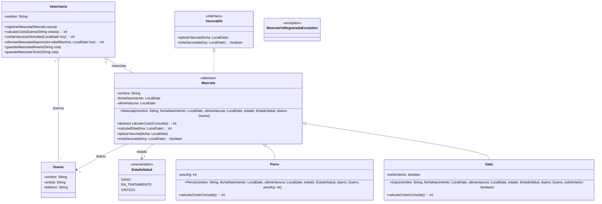

# Práctica 5 – Veterinaria: Mascotas, dueños y vacunas

Un programa administra una veterinaria que atiende perros y gatos. Cada mascota pertenece a un dueño, tiene un estado de salud y un registro de su última vacuna.

## Diagrama UML

## A. (15 puntos) Definición de clases y atributos
Defina todas las clases del diagrama (encabezado y **todos** los atributos). Las clases que representan datos (`Mascota`, `Perro`, `Gato` y `Dueno`) deben poder guardarse en un archivo binario.
1. Escriba el constructor de `Mascota`, `Perro` y `Gato`. Las listas de `Veterinaria` (`mascotas` y `duenos`) se crean vacías en su constructor.
2. `Mascota` es abstracta e implementa la interfaz `Vacunable`. Escriba sus métodos abstractos.
3. Escriba el enum `EstadoSalud` con los valores `SANO`, `EN_TRATAMIENTO` y `CRITICO`.
4. Escriba la interfaz `Vacunable` y la excepción verificada `MascotaYaRegistradaException` (hereda de `Exception`).
5. Escriba el método `calcularEdad` de `Mascota`: retorna los años cumplidos entre `fechaNacimiento` y la fecha `hoy` recibida.

## B. (65 puntos) Métodos por implementar

| Clase | Puntos | Método |
|---|---|---|
| Perro | 5 | **calcularCostoConsulta**: el costo es 40000 más 1000 por cada kilo de pesoKg. Si el estado de salud es CRITICO se suman 50000 adicionales. |
| Gato | 5 | **calcularCostoConsulta**: el costo es 35000. Si NO es de interior se suman 10000. Si el estado de salud es CRITICO se suman 50000 adicionales. |
| Mascota | 5 | **aplicarVacuna**: recibe la fecha de vacunación y la guarda como nueva última vacuna. Lanzar una excepción si la fecha es anterior a la última vacuna registrada. |
| Mascota | 5 | **estaVacunada**: retorna `true` si la vacuna está vigente, es decir, si la fecha `hoy` no es posterior a un año después de la última vacuna. En caso contrario la vacuna está vencida y retorna `false`. |
| Veterinaria | 10 | **registrarMascota**: agrega la mascota a la lista. Se considera repetida si ya existe una mascota con el mismo nombre (sin distinguir mayúsculas) y la misma cédula de dueño; en ese caso lanzar `MascotaYaRegistradaException`. Si el dueño de la mascota no está en la lista de dueños (misma cédula), también debe agregarse. |
| Veterinaria | 5 | **calcularCostoDueno**: recibe una cédula y retorna la suma de los costos de consulta de todas las mascotas de ese dueño. Lanzar una excepción si no existe un dueño con esa cédula en la lista de dueños. |
| Veterinaria | 5 | **contarVacunasVencidas**: retorna la cantidad de mascotas cuya vacuna está vencida a la fecha `hoy`. |
| Veterinaria | 10 | **eliminarMascotasMayores**: elimina de la lista todas las mascotas cuya edad (años cumplidos a la fecha `hoy`) sea mayor a `edadMaxima`. Retorna la cantidad de mascotas eliminadas. |
| Veterinaria | 5 | **guardarMascotasBinario**: guarda en un archivo binario todas las mascotas de la veterinaria. |
| Veterinaria | 10 | **guardarMascotasTexto**: guarda en un archivo de texto la información de todas las mascotas con el formato (una línea en blanco entre mascotas):  `Tipo de mascota: <Perro o Gato>` `Nombre: <nombre>` `Dueño: <nombre del dueño>` `Fecha de nacimiento: <fechaNacimiento>` `Estado de salud: <estado>` `Costo de consulta: <costo de consulta>` `Valor adicional: <para Perro el pesoKg y para Gato la palabra "Interior" o "Exterior" según esDeInterior>` |

Puede usar métodos desarrollados en otros puntos. Si usa métodos auxiliares no incluidos en el enunciado, debe implementarlos completamente.
