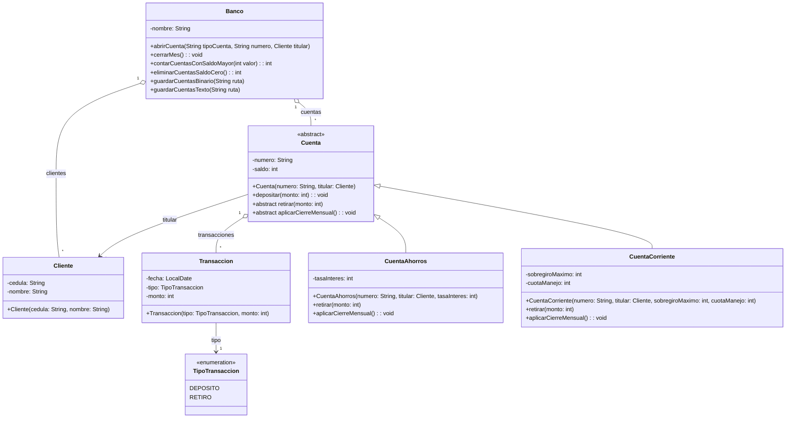

# Práctica 6 – Banco: Cuentas, clientes y transacciones

Un programa administra las cuentas y los clientes de un banco. Cada cuenta pertenece a un cliente y registra las transacciones (depósitos y retiros) que se realizan sobre ella.

## Diagrama UML

## A. (15 puntos) Definición de clases y atributos
Defina todas las clases del diagrama (encabezado y **todos** los atributos). Todos los montos y saldos son números enteros (`int`, en pesos). Las clases `Cuenta`, `Cliente` y `Transaccion` deben poder guardarse en un archivo binario.
1. Escriba el constructor de `Cuenta`, `CuentaAhorros`, `CuentaCorriente`, `Cliente`, `Transaccion` y `Banco`. Toda cuenta nueva inicia con saldo cero y con la lista de transacciones vacía. La fecha de una `Transaccion` es la fecha actual (`LocalDate.now()`). El constructor de `Banco` recibe solo el nombre y crea las listas de cuentas y clientes vacías.
2. `Cuenta` es abstracta. Escriba sus métodos abstractos: `retirar` y `aplicarCierreMensual`.
3. Defina el enum `TipoTransaccion` con los valores `DEPOSITO` y `RETIRO`.
4. Defina la excepción verificada `SaldoInsuficienteException` (hereda de `Exception`), que recibe el mensaje en su constructor.

## B. (65 puntos) Métodos por implementar

| Clase | Puntos | Método |
|---|---|---|
| Cuenta | 5 | **depositar**: suma el monto al saldo y agrega una transacción de tipo `DEPOSITO` con ese monto. Lanzar una excepción (`Exception`) si el monto es menor o igual a cero. |
| CuentaAhorros | 6 | **retirar**: resta el monto del saldo y agrega una transacción de tipo `RETIRO`. Una cuenta de ahorros **no permite sobregiro**: lanzar `SaldoInsuficienteException` si el monto es mayor que el saldo. Lanzar una excepción (`Exception`) si el monto es menor o igual a cero. |
| CuentaCorriente | 6 | **retirar**: resta el monto del saldo y agrega una transacción de tipo `RETIRO`. Una cuenta corriente permite sobregiro limitado: el saldo puede quedar negativo hasta `-sobregiroMaximo`. Lanzar `SaldoInsuficienteException` si el monto es mayor que saldo + sobregiroMaximo. Lanzar una excepción (`Exception`) si el monto es menor o igual a cero. |
| CuentaAhorros | 4 | **aplicarCierreMensual**: calcula el interés mensual como `saldo * tasaInteres / 100` (división entera). Si el interés es mayor que cero, lo suma al saldo y agrega una transacción `DEPOSITO` por ese valor. |
| CuentaCorriente | 4 | **aplicarCierreMensual**: descuenta la cuota de manejo (`cuotaManejo`) del saldo, aunque el saldo quede por debajo del sobregiro máximo, y agrega una transacción `RETIRO` por ese valor. |
| Banco | 8 | **abrirCuenta**: recibe un String "ahorros" o "corriente" con el tipo de cuenta a crear, el número y el titular, y agrega la cuenta al banco. Una cuenta de ahorros se crea con tasa de interés de 2 (2 %). Una cuenta corriente se crea con sobregiro máximo de 500000 y cuota de manejo de 10000. Lanzar una excepción si el tipo es desconocido. |
| Banco | 5 | **cerrarMes**: aplica el cierre mensual a todas las cuentas del banco (de forma polimórfica). |
| Banco | 8 | **contarCuentasConSaldoMayor**: retorna la cantidad de cuentas cuyo saldo sea mayor al valor recibido. |
| Banco | 8 | **eliminarCuentasSaldoCero**: elimina de la lista todas las cuentas con saldo igual a cero y retorna la cantidad de cuentas eliminadas. |
| Banco | 4 | **guardarCuentasBinario**: guarda en un archivo binario todas las cuentas del banco. |
| Banco | 7 | **guardarCuentasTexto**: guarda en un archivo de texto la información de todas las cuentas con el formato:  `Tipo de cuenta: <Ahorros o Corriente>` `Número: <numero>` `Titular: <nombre del titular>` `Saldo: <saldo>` `Transacciones: <cantidad de transacciones de la cuenta>` `Valor adicional: <para Ahorros la tasaInteres y para Corriente el sobregiroMaximo>` (una línea en blanco después de cada cuenta) |

Puede usar métodos desarrollados en otros puntos. Si usa métodos auxiliares no incluidos en el enunciado, debe implementarlos completamente.
