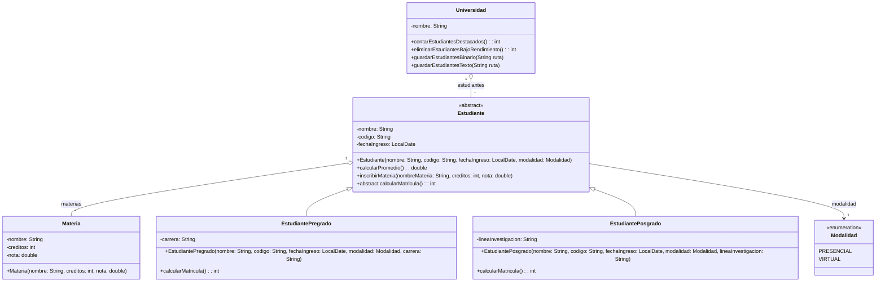

# Práctica 7 – Universidad: Estudiantes, materias y matrículas

Un programa administra los estudiantes de una universidad. Cada estudiante puede ser de pregrado o de posgrado, tiene una lista de materias inscritas (con sus créditos y su nota) y paga una matrícula que depende de su tipo.

## Diagrama UML

## A. (15 puntos) Definición de clases y atributos
Defina todas las clases del diagrama (encabezado y **todos** los atributos).
1. Escriba el constructor de `Universidad`, `Estudiante`, `EstudiantePregrado`, `EstudiantePosgrado` y `Materia`. Las listas de estudiantes (en `Universidad`) y de materias (en `Estudiante`) se crean vacías.
2. `Estudiante` es abstracta. Escriba su método abstracto.
3. Defina el enumerado `Modalidad` con los valores `PRESENCIAL` y `VIRTUAL`.
4. Defina la excepción propia verificada `CreditosExcedidosException` (hereda de `Exception`, recibe un mensaje).
5. Las clases que se guardan en el archivo binario deben ser serializables.

## B. (65 puntos) Métodos por implementar

| Clase | Puntos | Método |
|---|---|---|
| Estudiante | 10 | **calcularPromedio**: retorna el promedio de las notas de sus materias ponderado por los créditos: (suma de nota × créditos) / (suma de créditos). Si el estudiante no tiene materias, retorna 0.0. |
| EstudiantePregrado | 5 | **calcularMatricula**: retorna el valor de la matrícula: 350000 por cada crédito inscrito. |
| EstudiantePosgrado | 5 | **calcularMatricula**: retorna el valor de la matrícula: 500000 por cada crédito inscrito más un recargo fijo de 1200000. |
| Estudiante | 10 | **inscribirMateria**: recibe el nombre, los créditos y la nota de una materia y la agrega a la lista del estudiante. Un estudiante puede tener máximo 18 créditos inscritos en total: si al inscribir la materia se superan, lanzar `CreditosExcedidosException`. Si los créditos son menores o iguales a cero, lanzar una excepción con un mensaje apropiado. |
| Universidad | 10 | **contarEstudiantesDestacados**: retorna la cantidad de estudiantes cuyo promedio sea mayor a 4.0. |
| Universidad | 10 | **eliminarEstudiantesBajoRendimiento**: elimina de la universidad a todos los estudiantes cuyo promedio sea menor a 3.0 (incluidos los que no tienen materias) y retorna la cantidad de estudiantes eliminados. |
| Universidad | 5 | **guardarEstudiantesBinario**: guarda en un archivo binario todos los estudiantes de la universidad. |
| Universidad | 10 | **guardarEstudiantesTexto**: guarda en un archivo de texto la información de todos los estudiantes con el formato (una línea en blanco entre estudiantes):  `Tipo de estudiante: <Pregrado o Posgrado>` `Nombre: <nombre>` `Fecha de ingreso: <fechaIngreso>` `Modalidad: <modalidad>` `Promedio: <promedio redondeado a dos decimales>` `Matrícula: <valor de la matrícula>` |

Puede usar métodos desarrollados en otros puntos. Si usa métodos auxiliares no incluidos en el enunciado, debe implementarlos completamente.
