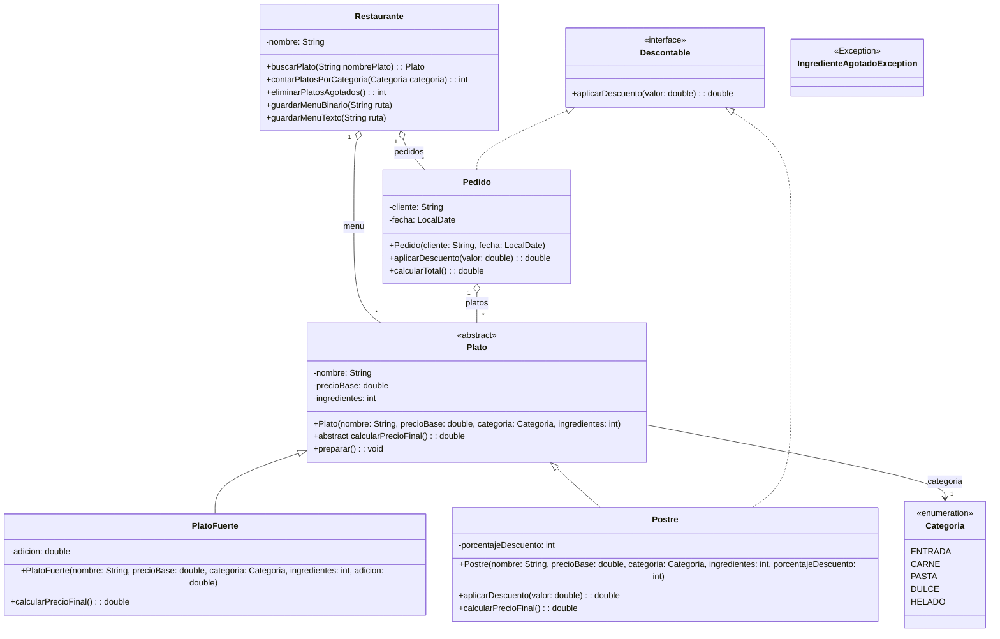

# Práctica 8 – Restaurante: Menú y pedidos

Un programa administra el menú y los pedidos de un restaurante. El menú tiene platos fuertes y postres, y cada plato pertenece a una categoría y gasta ingredientes cuando se prepara.

## Diagrama UML

## A. (15 puntos) Definición de clases y atributos
Defina todas las clases del diagrama (encabezado y **todos** los atributos). Las clases `Plato` y `Pedido` deben poder guardarse en un archivo binario.
1. Escriba el constructor de `Plato`, `PlatoFuerte`, `Postre`, `Pedido` y `Restaurante`. El constructor de `Pedido` crea la lista de platos vacía. El constructor de `Restaurante` recibe solo el nombre y crea el menú y la lista de pedidos vacíos.
2. `Plato` es abstracta. Escriba su método abstracto.
3. Escriba el enum `Categoria` con los valores `ENTRADA`, `CARNE`, `PASTA`, `DULCE` y `HELADO`.
4. Escriba la interfaz `Descontable`, que declara el método `aplicarDescuento` y es implementada por `Postre` y `Pedido`.
5. Escriba la excepción verificada `IngredienteAgotadoException`, que extiende de `Exception` y recibe un mensaje en su constructor.

## B. (65 puntos) Métodos por implementar

| Clase | Puntos | Método |
|---|---|---|
| PlatoFuerte | 5 | **calcularPrecioFinal**: retorna (precioBase + adicion) más una propina del 10% sobre ese valor. Ejemplo: precioBase 30000 y adicion 5000 → 38500. |
| Postre | 3 | **aplicarDescuento**: recibe un valor y retorna ese valor menos el porcentajeDescuento (porcentaje) de dicho valor. |
| Postre | 4 | **calcularPrecioFinal**: retorna el precioBase del postre con su descuento aplicado. |
| Pedido | 3 | **aplicarDescuento**: si el pedido tiene 4 o más platos retorna el valor recibido menos un 10%; en caso contrario retorna el mismo valor. |
| Pedido | 6 | **calcularTotal**: suma el precio final de todos los platos del pedido y retorna ese valor con el descuento del pedido aplicado. |
| Plato | 10 | **preparar**: gasta una unidad de los ingredientes del plato. Lanzar una `IngredienteAgotadoException` si el plato no tiene ingredientes disponibles (ingredientes en cero o menos). |
| Restaurante | 5 | **buscarPlato**: recibe el nombre de un plato (sin importar mayúsculas o minúsculas) y retorna el plato del menú. Lanzar una excepción si no existe. |
| Restaurante | 7 | **contarPlatosPorCategoria**: retorna la cantidad de platos del menú que pertenecen a la categoría recibida. |
| Restaurante | 7 | **eliminarPlatosAgotados**: elimina del menú todos los platos cuyos ingredientes sean cero o menos y retorna la cantidad de platos eliminados. |
| Restaurante | 5 | **guardarMenuBinario**: guarda en un archivo binario todos los platos del menú. |
| Restaurante | 10 | **guardarMenuTexto**: guarda en un archivo de texto la información de todos los platos del menú con el formato:  `Tipo de plato: <Fuerte o Postre>` `Nombre: <nombre>` `Categoría: <categoria>` `Precio base: <precioBase>` `Valor adicional: <para Fuerte la adicion y para Postre el porcentajeDescuento>` |

Puede usar métodos desarrollados en otros puntos. Si usa métodos auxiliares no incluidos en el enunciado, debe implementarlos completamente.
