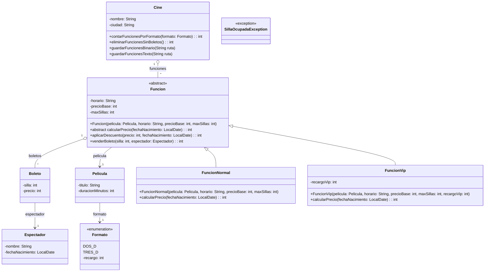

# Práctica 9 – Cine: Funciones y boletos

Un programa administra las funciones de un cine. Cada función proyecta una película, tiene un número máximo de sillas y guarda los boletos que se han vendido.

## Diagrama UML

## A. (15 puntos) Definición de clases y atributos
Defina todas las clases del diagrama (encabezado y **todos** los atributos). Las clases que se guardan en archivos binarios deben ser serializables.
1. Escriba el constructor de `Funcion`, `FuncionNormal` y `FuncionVip`. La lista de boletos se crea vacía.
2. `Funcion` es abstracta. Escriba su método abstracto.
3. Defina el enum `Formato` con los valores `DOS_D` (recargo 0) y `TRES_D` (recargo 6000). Cada valor guarda su recargo en el atributo `recargo`.
4. Defina la excepción propia `SillaOcupadaException` (excepción verificada que recibe un mensaje).

## B. (65 puntos) Métodos por implementar

| Clase | Puntos | Método |
|---|---|---|
| Funcion | 5 | **aplicarDescuento**: recibe un precio y la fecha de nacimiento del espectador. Calcula su edad en años a la fecha de hoy. Si es menor de 12 años, retorna el precio con 30% de descuento; si tiene 60 años o más, retorna el precio con 20% de descuento; en otro caso retorna el mismo precio. |
| FuncionNormal | 5 | **calcularPrecio**: retorna el precioBase más el recargo del formato de la película, con el descuento por edad aplicado. |
| FuncionVip | 5 | **calcularPrecio**: retorna el precioBase más el recargo del formato de la película más el recargoVip, con el descuento por edad aplicado. |
| Funcion | 15 | **venderBoleto**: recibe el número de silla y el espectador. Lanza una excepción si la silla no existe (menor a 1 o mayor a maxSillas). Lanza `SillaOcupadaException` si ya existe un boleto vendido para esa silla. En otro caso crea el boleto con el precio calculado con `calcularPrecio`, lo agrega a la lista y retorna el precio cobrado. |
| Cine | 10 | **contarFuncionesPorFormato**: retorna la cantidad de funciones cuya película tiene el formato recibido. |
| Cine | 10 | **eliminarFuncionesSinBoletos**: elimina de la lista todas las funciones que no tienen ningún boleto vendido y retorna la cantidad de funciones eliminadas. |
| Cine | 5 | **guardarFuncionesBinario**: guarda en un archivo binario todas las funciones del cine. |
| Cine | 10 | **guardarFuncionesTexto**: guarda en un archivo de texto la información de todas las funciones con el formato:  `Tipo de función: <Normal o VIP>` `Película: <titulo>` `Formato: <DOS_D o TRES_D>` `Horario: <horario>` `Boletos vendidos: <cantidad de boletos>` `Recaudado: <suma de los precios de los boletos>` |

Puede usar métodos desarrollados en otros puntos. Si usa métodos auxiliares no incluidos en el enunciado, debe implementarlos completamente.
